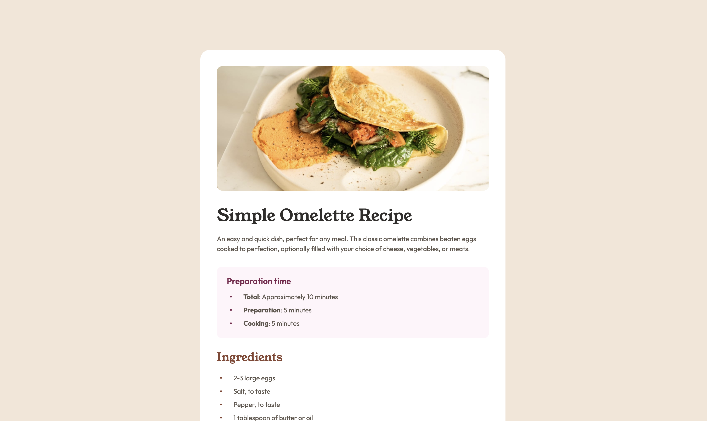

# Frontend Mentor - Recipe page solution

This is a solution to the [Recipe page challenge on Frontend Mentor](https://www.frontendmentor.io/challenges/recipe-page-KiTsR8QQKm). Frontend Mentor challenges help you improve your coding skills by building realistic projects. 

## Table of contents

- [Overview](#overview)
  - [The challenge](#the-challenge)
  - [Screenshot](#screenshot)
  - [Links](#links)
- [My process](#my-process)
  - [Built with](#built-with)
  - [What I learned](#what-i-learned)
  - [Continued development](#continued-development)
  - [Useful resources](#useful-resources)
  - [AI Collaboration](#ai-collaboration)
- [Author](#author)

## Overview

### Screenshot



### Links

- Solution URL: [Add solution URL here](https://your-solution-url.com)
- Live Site URL: [Add live site URL here](https://your-live-site-url.com)

## My process

### Built with

- Semantic HTML5 markup
- CSS custom properties
- Flexbox
- Mobile-first workflow

**Note: These are just examples. Delete this note and replace the list above with your own choices**

### What I learned

One of the things that stuck with me after finishing this project was the CSS counters. It was interesting to see how you can create some incrementing variables in CSS, which is not a programming language and you can increment them by setting some incrementing rules, like "increment this variable as you display more elements like this". I will show the snippet where I used it:

```css
ol {
    list-style-type: none;
    counter-reset: section;
}

.ordered-list-item::before {
    counter-increment: section;
    content: counter(section) ".";
}
```

### Continued development

This project, I think, make me realised the limits of writing CSS code - a lot of hard to read code. Therefore, SASS is my next stop in my learning path.

### Useful resources

- [Media Queries](https://www.w3schools.com/css/css_rwd_mediaqueries.asp) - If you need to get more familiar with media queries in CSS, this is a good place to go
- [<table> element](https://developer.mozilla.org/en-US/docs/Web/HTML/Reference/Elements/table) - I'm new to using tables in html so this article was a good starting point to understand how to use them
- [::before Pseudo-element](https://developer.mozilla.org/en-US/docs/Web/CSS/::before) - This one was a big helper to see how to create my own dots and numbers so that I can use spacing easier.
- [border-colapse property](https://developer.mozilla.org/en-US/docs/Web/CSS/border-collapse) - Without this, it would have been tricky to create the table borders the way it was displayed in the design files. 


### AI Collaboration

I used AI for debugging and QA issues. It's so good to have it compare my solution with the figma file. That's some real good feedback loop!! I used mostly Cursor with the Claude Opus 5.5 model. 

## Author

- Website - [Alex Ionita](https://github.com/Alexandru736)
- Frontend Mentor - [@Alexandru736](https://www.frontendmentor.io/profile/Alexandru736)
